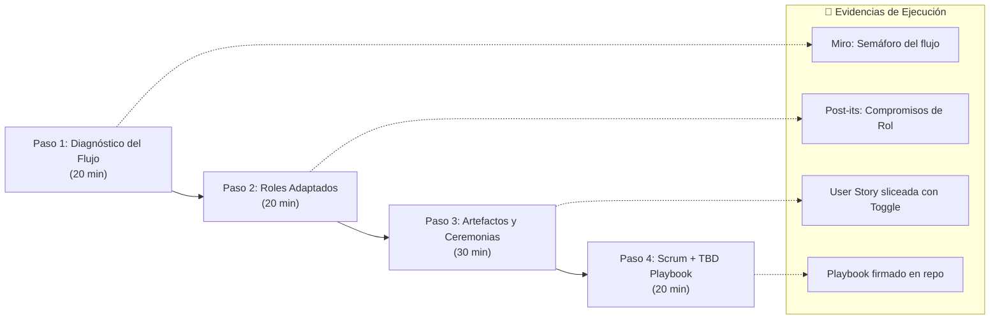

# 📘 Informe de Taller Práctico: Adaptación de Scrum a Trunk-Based Development (TBD) y Despliegue Continuo (CD)

---

## 📌 Ficha Técnica del Taller

* **Nombre del Taller:** Taller 1 - Optimización y Adaptación de Scrum a TBD y Continuous Deployment.
* **Modalidad:** Hands-on colaborativo + facilitación guiada (No expositivo).
* **Nivel:** Profesional / Ingeniería de Software.
* **Stack Tecnológico Base:**
  * **Lenguaje y Pruebas:** Python 3.11, Pytest, Ruff (Linter).
  * **Contenerización y Registro:** Docker, GitHub Container Registry (GHCR).
  * **Integración y Despliegue Continuo:** GitHub Actions (`.github/workflows/ci.yaml`).
  * **Herramientas de Facilitación:** Miro / Pizarra digital, GitHub Projects, Repositorio Git.
* **Entregable Principal:** *Scrum + TBD Playbook* (Acuerdos de trabajo vivos para el equipo).

---

## 🧭 Estructura General del Taller y Evidencias Requeridas



---

## 🔬 PASO 1: Diagnóstico del Flujo Actual (20 min)

### 1.1 Objetivo
Visualizar el recorrido real que hace el código desde el entorno local del desarrollador hasta producción, evidenciando cuellos de botella, esperas ocultas e inercias culturales que impiden la integración diaria a la rama principal (`main`).

### 1.2 Mapeo del Flujo de Trabajo en Tablero

El equipo proyecta y reconstruye su pipeline actual en una sola columna secuencial:

```
[ 1. Commit Local ]
         ↓
[ 2. Push & Creación de Pull Request (PR) ]
         ↓
[ 3. Pipeline CI Automático: Ruff (Linter) + Pytest ]
         ↓
[ 4. Code Review Humano por Pares ]
         ↓
[ 5. Merge a la rama 'main' ]
         ↓
[ 6. Build de Imagen Docker & Push a GHCR ]
         ↓
[ 7. ¿Despliegue a Staging / Producción? (Manual / Inexistente) ]
```

### 1.3 Dinámica del Semáforo de Dolor (Silent Brainstorming - 7 min)
Cada integrante del equipo añade notas adhesivas digitales sobre el flujo usando tres categorías cromáticas:

* 🟢 **Verde (Fluidez y confianza):** Lo que hoy funciona de manera rápida, automatizada y confiable.
* 🟡 **Amarillo (Fricción y espera):** Etapas lentas, dependencias de personas, burocracia o revisiones tardías.
* 🔴 **Rojo (Pánico y rotura):** Pasos propensos a errores, miedo a romper ambientes, resolución de conflictos dolorosos al integrar ramas antiguas.

---

### 1.4 Hallazgos Críticos: Las 3 Preguntas de Choque

| Pregunta de Diagnóstico | Realidad Observada en el Equipo | Impacto en TBD / CD |
| :--- | :--- | :--- |
| **1. ¿Cuánto tiempo vive normalmente una rama antes de integrarse a `main`?** | De 3 a 5 días promedio. En features complejas, hasta 2 semanas. | **Crítico:** Rompe TBD. Provoca 'merge hell' y desacople de versiones entre desarrolladores. |
| **2. ¿Qué tan seguido integramos realmente a `main`?** | Se integra al final del sprint o en 'días de merge' asignados. | **Alto:** El CI solo prueba cambios masivos agrupados (batch size gigante), dificultando aislar errores. |
| **3. ¿Nuestro DoD incluye 'está en main y es desplegable sin romper'?** | No; 'Done' suele significar 'aprobado por QA en local o rama aislada'. | **Crítico:** Desacopla el desarrollo del release, acumulando riesgo hacia el final del ciclo. |

---

### 1.5 Matriz de Fricciones Priorizadas (Resultado del Paso 1)

1. **Ramas de Larga Duración (Batch Size Gigante):** Los desarrolladores acumulan muchos commits en ramas aisladas por miedo a desestabilizar el trabajo de otros.
2. **Cuello de Botella en Code Review:** Los PRs grandes permanecen estancados entre 24 y 48 horas esperando revisión de pares.
3. **Miedo al Deploy:** La automatización compila la imagen Docker en GHCR, pero no existe validación con Feature Toggles ni monitoreo post-despliegue en producción.
4. **Falso 'Done':** Tareas marcadas como cerradas en el tablero pero cuyo código aún no convive en `main`.

---

### 📷 Guía de Capturas de Pantalla para el Informe (Evidencias Paso 1)

Para documentar este primer paso en el informe final, se deben adjuntar las siguientes capturas reales:

* [ ] **Captura 1.1 - Tablero de Miro con el Semáforo de Dolor:**
  * *Qué debe mostrar:* El diagrama del flujo completo con los post-its verdes, amarillos y rojos agrupados en cada fase.
  * *Ubicación recomendada en informe:* Debajo de la sección 1.3.
* [ ] **Captura 1.2 - Historial de Pull Requests en GitHub:**
  * *Qué debe mostrar:* La pestaña *Pull requests* del repositorio mostrando fechas de creación y cierre para evidenciar el tiempo de vida de las ramas antes del taller.
  * *Ubicación recomendada en informe:* Debajo de la tabla de preguntas de choque (sección 1.4).
* [ ] **Captura 1.3 - Pipeline de GitHub Actions (`ci.yaml`):**
  * *Qué debe mostrar:* El workflow ejecutado en verde con los jobs `test` (Ruff + Pytest) y `build_and_push` (Docker a GHCR).
  * *Ubicación recomendada en informe:* Al final del Paso 1 como evidencia de la base técnica actual.

---
*(Continúa en el Paso 2: Roles adaptados a TBD + Continuous Deployment)*
